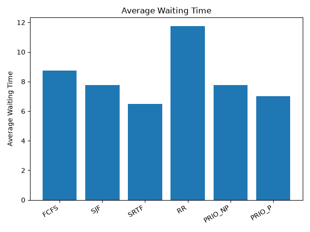
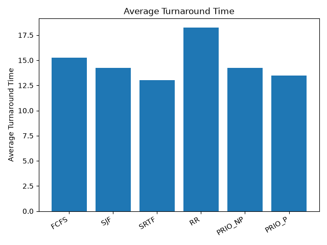

# CPU Scheduling Simulator in Python

A Python-based CPU Scheduling Simulator designed to implement, analyze, and compare different process scheduling algorithms used in operating systems.

## Project Overview

This project simulates how an operating system schedules processes based on arrival time, burst time, and priority.

It evaluates six scheduling algorithms and compares their performance using waiting time, turnaround time, response time, and context switches.

## Technologies Used

- Python
- Matplotlib
- argparse
- dataclasses
- collections.deque
- deepcopy

## Implemented Algorithms

1. First Come First Served (FCFS)
2. Shortest Job First (SJF)
3. Shortest Remaining Time First (SRTF)
4. Round Robin (RR)
5. Priority Scheduling (Non-Preemptive)
6. Priority Scheduling (Preemptive)

## Key Features

- Implementation of six CPU scheduling algorithms
- Process management using arrival time, burst time and priority
- Gantt chart-style scheduling visualization
- Calculation of waiting, turnaround and response times
- Algorithm performance comparisons
- Graphical visualization using Matplotlib
- Command-line execution

## How It Works

1. Process information is read from a text file.
2. The selected scheduling algorithm is executed.
3. Process execution order is simulated.
4. Performance metrics are calculated.
5. Results are displayed in the terminal.
6. Comparison graphs are generated.

## Installation

Clone the repository:

```bash
git clone https://github.com/Azraeerbass/Process-Scheduling-Simulator-in-Python.git
cd Process-Scheduling-Simulator-in-Python
```

Install required libraries:

```bash
python3 -m pip install -r requirements.txt
```

Run all algorithms:

```bash
python3 scheduler.py --input processes.txt --all --quantum 4
```

## Sample Results

| Algorithm | Avg. Waiting | Avg. Turnaround |
|---|---:|---:|
| FCFS | 8.75 | 15.25 |
| SJF | 7.75 | 14.25 |
| SRTF | 6.50 | 13.00 |
| RR | 11.75 | 18.25 |
| Priority NP | 7.75 | 14.25 |
| Priority P | 7.00 | 13.50 |

For the included sample process data, SRTF achieved the lowest average waiting time.

## Performance Visualizations

### Average Waiting Time



### Average Turnaround Time



## Learning Outcomes

This project provided practical experience in:

- CPU scheduling and operating system concepts
- Python algorithm implementation
- Queue-based process management
- Performance analysis
- Data visualization
- Comparing different algorithmic approaches

## Project Type

Academic project focused on Operating Systems, CPU Scheduling and Algorithm Analysis.
